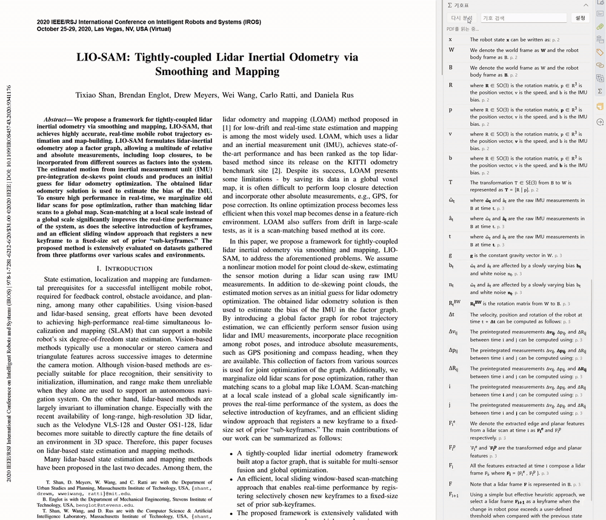

# zotero-math-tidy

[English](README.md) | 한국어

논문을 읽다가 "이 기호가 뭐였지?" 하고 앞으로 되돌아가지 않도록, 논문에 나오는 수학 기호와 그 기호를 정의한 원문 문장을 PDF 옆에 모아 보여 주는 Zotero 플러그인입니다.

| 기호 | 논문이 정의한 문장 |
| --- | --- |
| **W** | We denote the world frame as **W** and the robot body frame as B. |
| **g** | **g** is the constant gravity vector in W. |
| **ω̂<sub>t</sub>** | where **ω̂<sub>t</sub>** and â<sub>t</sub> are the raw IMU measurements in B at time t. |

모든 내용은 이 컴퓨터에서 PDF 자체로부터 뽑습니다. API 키도 계정도 필요 없고, 어디로도 전송하지 않습니다.



## 사용법

1. PDF를 열면 오른쪽 아이템 패널의 **기호표** 섹션이 몇 초 안에 저절로 채워집니다.
2. 각 행에는 기호와 그 기호를 정의한 문장, 쪽 번호가 나옵니다. 회색 행은 논문이 자주 쓰지만 문장으로 정의하지 않은 기호로, 처음 사용된 문장을 보여 줍니다.
3. 행을 클릭하면 PDF에서 그 문장으로 이동하고, 다시 클릭하면 그 기호의 다음 위치로 넘어갑니다.
4. PDF 본문의 기호 위에 마우스를 올리면 정의 문장이 말풍선으로 뜹니다.
5. 검색창으로 기호나 문장을 걸러 볼 수 있고, **다시 분석**으로 목록을 새로 만듭니다.

결과는 PDF별로 저장되어 다음에 열 때 바로 보입니다. 80쪽이 넘는 PDF는 자동으로 분석하지 않으니 **분석**을 눌러 주세요. 라이브러리에서 **분석**을 누르면 PDF를 먼저 엽니다. 글자 정보를 리더를 통해 읽기 때문입니다.

## 동작 방식

Zotero 리더는 PDF의 모든 글자를 위치, 글꼴, 크기와 함께 알고 있습니다. 플러그인은 이 정보를 이렇게 씁니다.

- **기호 찾기**: 본문과 다른 글꼴로 쓰인 글자(또는 그리스 문자)를, 그 위에 그려진 강조 기호와 아래·위에 작게 붙은 글자까지 묶어 `ω̂_t`나 `M_i^e` 같은 하나의 기호로 읽습니다.
- **정의 찾기**: 기호가 들어간 문장 중 정의처럼 읽히는 문장을 고릅니다. "X is the …", "X denotes …", "where X …", "let X …", "we denote … as X", "the rotation matrix X" 같은 형태입니다. 함께 나열된 기호들("where k, u, v, and w are …")은 같은 문장을 공유합니다.

언어 모델이 아니라 규칙으로 하는 일이라 한계가 있습니다.

- 문장을 원문 그대로 인용합니다. 번역이나 요약은 없습니다.
- 기호를 언급만 한 문장을 정의로 잘못 고를 수 있습니다.
- 수식 안에서만 정의되거나 관례로 쓰는 기호는 사용된 문장을 보여 주고, 한두 번만 나오면 목록에서 빠집니다.
- 인덱스가 다르면 다른 항목입니다. `x_i`와 `x_{i+1}`이 따로 나옵니다.
- 서로 붙여 쓴 글자(`Wx`의 `x`)는 기호로 읽지 않습니다.
- 스캔본이나 수식이 이미지로 들어간 PDF는 읽을 글자가 없습니다.

## 설정

Zotero 설정 → **Math Tidy**

- **플러그인 언어**: 영어, 한국어, 또는 Zotero와 동일.

기호표는 Zotero 데이터 폴더의 `math-tidy/`에 PDF별 JSON 파일로 저장됩니다.

## 설치

```powershell
.\build.ps1
```

`build/math-tidy.xpi`가 만들어집니다. Zotero의 도구 → 플러그인 → 톱니바퀴 → *Install Plugin From File…*에서 선택하세요. Zotero 7 이상이 필요하며, Zotero 9에서 개발하고 테스트했습니다.

Zotero가 플러그인용 API를 제공하지 않는 리더 내부 정보를 읽기 때문에, Zotero가 업데이트되면 동작하지 않을 수 있습니다.

## 개발

빌드 단계 없이 `addon/` 폴더가 그대로 플러그인입니다.

- `addon/bootstrap.js` — 진입점
- `addon/src/math-tidy.js` — 설정, 결과 저장, 분석 실행
- `addon/src/extractor.js` — 쪽의 글자에서 기호와 정의 문장 찾기
- `addon/src/matcher.js` — 알려진 기호가 쪽의 어디에 나오는지 찾기
- `addon/src/notation.js` — 기호 표기(첨자, 강조 기호)와 렌더링
- `addon/src/reader.js` — 리더에서 글자 읽기, 기호로 이동, 마우스 올리면 정의 표시
- `addon/src/section.js` — 아이템 패널의 기호표 섹션
- `addon/preferences.xhtml`, `addon/preferences.js`, `addon/prefs.js` — 설정 화면과 기본값
- `addon/locale/en-US/math-tidy-en.ftl`, `math-tidy-ko.ftl` — 영어와 한국어 문구

소스에서 바로 불러오려면 Zotero 프로필의 `extensions/` 폴더에 `math-tidy@meteor0108.github.io`라는 이름의 텍스트 파일을 만들고 `addon` 폴더의 절대 경로를 적은 뒤 Zotero를 다시 시작합니다.

## 라이선스

[MIT](LICENSE)
